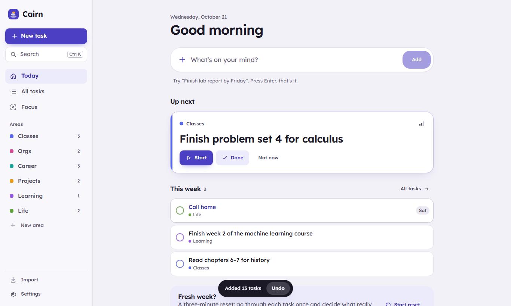

# Cairn

**One step at a time.** A calm to-do app built for brains that get overwhelmed by long lists.
Type what's on your mind, press Enter, and Cairn files it, dates it and tells you what to do next.
Free, private, no sign-up.

**Try it: <https://rmaytr.github.io/TasksApp/>**



_A cairn is the small stack of stones hikers leave to mark the trail: you only ever need to find the
next one._

## Why another to-do app?

Most lists turn into a guilt pile: one long column, red overdue badges, and no sense of what matters
right now. Cairn is designed around a few ADHD-friendly rules:

- **One box to add things.** No form. Area, date and priority are read from your words
  (“Finish lab report by Friday !”) and shown as a quiet preview you can correct but never have to.
- **One thing at a time.** *Today* shows a single **Up next** card (Start · Done · Not now), a short
  list for today and this week, and nothing else.
- **Gentle reminders.** A *Coming up* strip shows what's due today or tomorrow, and optional
  notifications arrive the evening before and the morning of a deadline.
- **Order that makes sense.** Tasks can wait for other tasks (“do after”), and the planner orders
  everything by deadline, priority, size and what's blocking what.
- **Areas are pages.** Click *Classes* and you see only your classes, by when.

### Views

- **Today.** Capture, Up next, today and this week.
- **All tasks.** List (search, sort by smart order, due date or priority, reverse, show done),
  **Map** (a mind map of areas and tasks; an outline on phones) or **Radar** (rings from Today to
  Someday, slices per area; drag a dot closer to do it sooner).
- **Lock in.** For when everything feels like too much: Cairn (with the assistant, if it's on) picks
  one task and shows only its next small step, says why it's first, and can break a big task into
  smaller steps. Each thing you finish adds a stone to your cairn.
- **Weekly reset.** A three-minute sweep: pull closer, keep, push out, done or drop, one card at a time.

Quick actions: the ⋯ next to an area (or right-click it) adds a task there, renames, recolours,
reorders or deletes it; the ⋯ on a task row (or right-click) sets a date, flags it, locks in, moves or
deletes it; drag a task onto an area or onto Today in the sidebar to move it. On a phone, swipe a
task right to finish it or left to snooze it (one day later, or one step out if it has no date).

Also: High / Normal / Low priority, steps, repeating tasks, links in notes become chips, `Ctrl K`
finds anything, light and dark themes, installable and works offline.

## The assistant (optional)

Turn it on in **Settings → Assistant** and describe a task in plain words:

> Publish the domain for the BOR Realty site this weekend and add it to my portfolio and resume

Claude turns that into one task with steps in the order they have to happen (connect the domain,
check the site is live, add it to the portfolio, update the resume), picks the area, reads “this
weekend” as Saturday and sets priority. If you already have related tasks, like “Update resume”, it
marks them *do after* the new one so they wait their turn. A note listing unrelated things
(“buy milk, call the dentist, finish the essay”) becomes separate tasks. **Plan my day** proposes an order for everything open and suggests links between
tasks, which you accept or skip. Every change is one Undo away.

It's off by default. Use **your own Anthropic API key** (stored only in your browser) or an **invite
code** if the person who shared Cairn runs the proxy in [`worker/`](worker/README.md). Only the new
task's text and the titles, areas, due dates and priorities of open tasks are sent; notes and steps
never leave your device. Details in the [privacy policy](docs/PRIVACY.md).

## Getting your tasks in

- **Type them.** The capture box understands `#area`, `!` (high priority), dates like `fri`,
  `this weekend`, `nov 3` or `in 2 weeks`, rings like `@week` or `@someday`, and sizes `~s ~m ~l`.
  Without `#area`, the area is guessed from the words. Example: `Email mentee #orgs tomorrow !`
- **Import a file or paste a list.** Plain text, numbered lists, Markdown checklists, JSON or CSV
  (Todoist exports work). `Title: step one, step two` becomes a task with steps. You review
  everything before it's added.
- **Back up.** Settings → *Back up (JSON)* or *Export Markdown*.

### JSON import format

```json
[
  {
    "title": "Apply for scholarship",
    "area": "Career",
    "horizon": "week",
    "priority": "high",
    "effort": "m",
    "due": "2026-11-15",
    "waiting": null,
    "plan": "Sunday afternoon at the library",
    "notes": "",
    "steps": ["Get rec letter", "Research the application"]
  }
]
```

`horizon` is one of `today | week | month | later | someday`; `effort` is `s | m | l`.
Only `title` is required.

## Privacy

By default everything is stored in your browser (IndexedDB): no account, no analytics, no cookies.
Install it from your browser menu (“Install app” or “Add to Home Screen”) to use it like a native app,
offline.

**Optional sync** (if the deployment has it turned on): sign in with a one-time email code and
choose an encryption passphrase. Tasks are encrypted on your device before upload, so the server only
ever stores ciphertext. Details: [docs/SYNC.md](docs/SYNC.md), [privacy policy](docs/PRIVACY.md),
[SECURITY.md](SECURITY.md). Operators: [docs/DEPLOY.md](docs/DEPLOY.md).

## Keyboard

| Key | Action |
| --- | --- |
| `/` or `n` | Add a task |
| `Ctrl K` | Find any task |
| `1` `2` `3` | Today, All tasks, Lock in |
| `i` | Import |
| `z` | Undo the last change |
| `Esc` | Close the open task or dialog |
| `?` | Settings and shortcuts |

## Development

```bash
npm install
npm run dev          # http://localhost:5173
npm test             # unit tests (Vitest)
npm run test:e2e     # end-to-end tests (Playwright)
npm run build        # production build in dist/
```

Stack: Vite 8, React 19, TypeScript, Zustand (persisted to IndexedDB), Zod, Motion, vite-plugin-pwa;
optional Supabase (Auth + Postgres with RLS) for encrypted sync; optional Claude API
(`@anthropic-ai/sdk`) for the assistant, directly or through a Cloudflare Worker.
See [docs/REVAMP.md](docs/REVAMP.md) (current design and plan), [docs/PRD.md](docs/PRD.md),
[docs/ARCHITECTURE.md](docs/ARCHITECTURE.md), [docs/RESEARCH.md](docs/RESEARCH.md) and
[docs/RELEASE.md](docs/RELEASE.md).

Every push to `main` deploys to GitHub Pages: <https://rmaytr.github.io/TasksApp/>.

## License

MIT
